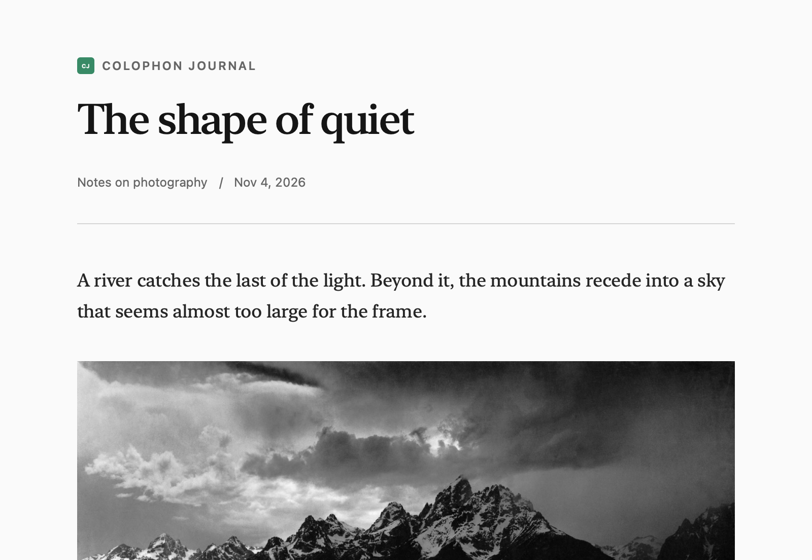

# Colophon

A photographic journal for NetNewsWire. Expressive serif typography, quiet metadata, fine rules, and neutral light and dark appearances give articles and photographs room to breathe.

Designed for macOS, iPhone, and iPad. Colophon uses Apple’s built-in serif and system fonts, respects reader text-size settings, and preserves the original colors of article images. No font downloads or theme scripts are required.



## Install

For a local build, run `npx nnw-theme@2 check --no-open`. The installable archive is `build/release/Colophon.nnwtheme.zip`.

- **Mac:** unzip the archive, double-click `Colophon.nnwtheme`, and confirm installation.
- **iPhone / iPad:** transfer the ZIP to your device and share it to NetNewsWire.

Choose Colophon in NetNewsWire’s article theme settings. This theme has not yet been published as a GitHub release.

## Develop and preview

Use Node.js 24 or later. Run tooling through npx; do not add it as a repository dependency.

```sh
npx nnw-theme@2 setup
npx nnw-theme@2 preview
npx nnw-theme@2 check --no-open
```

The generated gallery is `build/preview/index.html`. Checks cover macOS, iPhone, iPad, light and dark appearances, larger text, older enclosure handling, and Article JavaScript off. Fixtures additionally exercise Ghost, Medium, Substack, WordPress, podcasts, and media enclosures. Preview content is offline.

The theme lives in `Colophon.nnwtheme/`. Make visual changes in `stylesheet.css`; `template.html` contains the article scaffold and `Info.plist` contains the stable identity. Before a release, increase the integer version with `npx nnw-theme@2 bump` and rerun the checks.

The preview photograph is Ansel Adams’s *The Tetons and the Snake River* (1942), public domain; see [source and attribution](fixtures/media/README.md). It is a fixture only and is not part of the installed theme.

## License

Theme: [0BSD](Colophon.nnwtheme/LICENSE). Starter repository infrastructure: [Apache-2.0](LICENSE).
